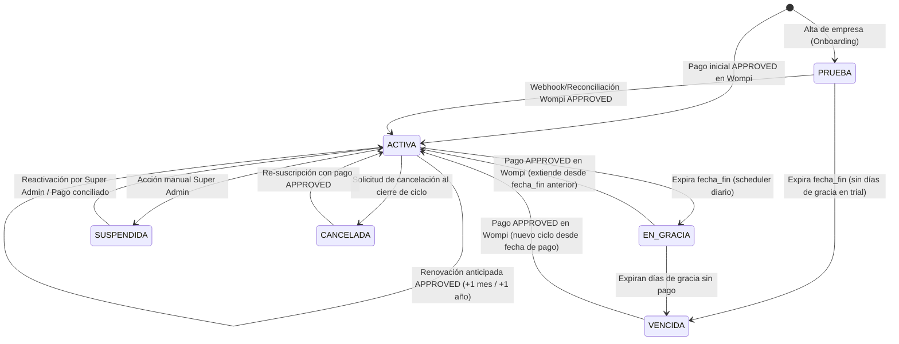

# FASE B0 — Diseño Técnico y Contrato de Integración con Wompi Colombia (sys-POS SaaS)

> **Estado:** Fase B0 (Diseño técnico y contrato únicamente — CERO código productivo, migraciones ni llamadas HTTP reales ejecutadas).  
> **Fecha:** 2026-10-19  
> **Rama:** `noche/auditoria-y-rediseno`

---

## 1. Estados de Suscripción y Diagrama de Transiciones

### 1.1 Catálogo de Estados (`App\Enums\EstadoSuscripcion`)

Actualmente `App\Enums\EstadoSuscripcion` contempla `ACTIVA`, `PRUEBA` (`TRIAL`), `SUSPENDIDA`, `CANCELADA` y `VENCIDA`. Para soportar el ciclo de facturación SaaS con Wompi Colombia se formalizan los siguientes **6 estados canónicos**:

| Estado | Código | ¿Operativa (Escritura)? | ¿Permite Lectura/Exportación? | Descripción |
|---|---|---|---|---|
| **Período de Prueba** | `PRUEBA` (`TRIAL`) | ✅ Sí | ✅ Sí | Período inicial sin cobro tras el alta del tenant (`fecha_fin = now() + N días`). |
| **Activa** | `ACTIVA` | ✅ Sí | ✅ Sí | Suscripción pagada y vigente (`fecha_fin >= now()`). |
| **En Gracia** | `EN_GRACIA` | ✅ Sí (con banner de aviso) | ✅ Sí | `fecha_fin` venció hace menos de `dias_gracia` días; permite operar mientras el comercio regulariza el pago. |
| **Vencida** | `VENCIDA` | ❌ No (solo lectura + pago) | ✅ Sí | Expiró el período de prueba o los días de gracia sin pago `APPROVED` en Wompi. |
| **Suspendida** | `SUSPENDIDA` | ❌ No (solo lectura + pago) | ✅ Sí | Suspendida administrativamente por Super Admin o por contracargo/fraude reportado. |
| **Cancelada** | `CANCELADA` | ❌ No (solo lectura + exportación) | ✅ Sí | Baja voluntaria solicitada por el cliente al finalizar el ciclo. |

### 1.2 Diagrama de Transiciones (Mermaid)



---

## 2. Modelo de Datos Propuesto (Sin Ejecutar Migraciones)

### 2.1 Tabla existente `planes` (ajustes propuestos en Fase B1)
La migración `2026_03_20_175000_create_planes_and_suscripciones_tables.php` ya define `planes` con `precio_mensual`, `precio_anual`, `limite_sucursales`, `limite_usuarios`, `permite_facturacion_electronica`, `permite_api`.
- **Campos adicionales propuestos:**
  - `moneda` (`char(3)`, default `'COP'`)
  - `dias_prueba` (`unsignedSmallInteger`, default `14`)
  - `orden_visual` (`unsignedTinyInteger`, default `1`)

### 2.2 Tabla existente `suscripciones` (ajustes propuestos en Fase B1)
- **Campos adicionales propuestos:**
  - `fecha_gracia_fin` (`timestamp`, nullable) — límite exacto del estado `EN_GRACIA`.
  - `renovacion_automatica` (`boolean`, default `false`).
  - `cancelada_en` (`timestamp`, nullable).
  - `ultimo_pago_id` (`foreignId`, nullable, FK a `pagos_suscripcion.id`).

### 2.3 Nueva tabla `pagos_suscripcion` (Intenciones e Historial de Transacciones)
Registra cada intento de pago generado desde `sys-POS` hacia Wompi:

| Columna | Tipo | Restricciones | Propósito |
|---|---|---|---|
| `id` | `bigIncrements` | PK | Identificador interno |
| `empresa_id` | `foreignId` | FK `empresas.id`, index | Tenant que realiza el pago |
| `suscripcion_id` | `foreignId` | nullable, FK `suscripciones.id` | Suscripción objetivo |
| `plan_id` | `foreignId` | FK `planes.id` | Plan contratado en este intento |
| `user_id` | `foreignId` | nullable, FK `users.id` | Usuario que inició el checkout |
| `ciclo_facturacion` | `string(20)` | `MENSUAL` \| `ANUAL` | Ciclo seleccionado |
| `reference` | `string(80)` | **UNIQUE**, index | Referencia única generada por `sys-POS` (`POS-{empresa_id}-{ulid}`) |
| `amount_in_cents` | `unsignedBigInteger` | NOT NULL | Monto exacto en centavos COP (ej. `$49.900,00 COP` = `4990000`) |
| `currency` | `char(3)` | default `'COP'` | Moneda exigida por Wompi (`COP`) |
| `integrity_signature` | `string(64)` | NOT NULL | Hash SHA-256 generado al crear el intento |
| `wompi_transaction_id` | `string(64)` | nullable, **UNIQUE** | ID de transacción asignado por Wompi (`12345-1699999999-99999`) |
| `status` | `string(24)` | index, default `'PENDING'` | `PENDING`, `APPROVED`, `DECLINED`, `VOIDED`, `ERROR`, `AMOUNT_MISMATCH` |
| `payment_method_type` | `string(40)` | nullable | `CARD`, `NEQUI`, `PSE`, `BANCOLOMBIA_TRANSFER`, `BANCOLOMBIA_QR` |
| `status_message` | `string(255)` | nullable | Motivo de rechazo o mensaje informativo |
| `paid_at` | `timestamp` | nullable | Fecha/hora de aprobación confirmada |
| `expires_at` | `timestamp` | NOT NULL | Caducidad de la intención local (`now()->addHours(2)`) |
| `raw_response` | `json` | nullable | Snapshot sanitizado de la respuesta de Wompi |
| `timestamps` | `timestamp` | `created_at`, `updated_at` | Auditoría temporal |

### 2.4 Nueva tabla `wompi_webhook_events` (Bitácora Idempotente de Eventos)
Garantiza idempotencia estricta y trazabilidad forense de cada webhook o reconciliación:

| Columna | Tipo | Restricciones | Propósito |
|---|---|---|---|
| `id` | `bigIncrements` | PK | Identificador interno |
| `event_id` | `string(100)` | **UNIQUE** | Hash único del evento o `data.transaction.id + ':' + data.transaction.status + ':' + timestamp` |
| `event_type` | `string(60)` | index | Ej. `transaction.updated` |
| `wompi_transaction_id` | `string(64)` | index | `data.transaction.id` |
| `reference` | `string(80)` | nullable, index | `data.transaction.reference` |
| `transaction_status` | `string(24)` | NOT NULL | Estado reportado en el evento |
| `signature_valid` | `boolean` | NOT NULL | `true` si pasó validación criptográfica |
| `processed_at` | `timestamp` | nullable | Momento en que aplicó efectos de negocio |
| `processing_result` | `string(40)` | NOT NULL | `PROCESSED`, `DUPLICATE_IGNORED`, `INVALID_SIGNATURE`, `AMOUNT_MISMATCH`, `NOT_FOUND` |
| `ip_address` | `string(45)` | nullable | IP origen del webhook |
| `payload` | `json` | NOT NULL | Cuerpo JSON íntegro recibido |
| `created_at` | `timestamp` | NOT NULL | Timestamp de recepción |

---

## 3. Flujo de Pago y Firma de Integridad SHA-256

### 3.1 Generación de Intención y `reference` Única
1. El `Admin de Empresa` selecciona el plan y ciclo (`MENSUAL` o `ANUAL`) en `/suscripcion/checkout`.
2. El servidor lee el precio oficial desde la tabla `planes` en base de datos (**jamás desde el request del navegador**).
3. Convierte el monto a centavos enteros:
   $$\text{amount\_in\_cents} = \text{round}(\text{precio\_cop} \times 100)$$
4. Genera una referencia única no reutilizable por cada intento:
   $$\text{reference} = \text{"POS-"} + \text{empresa\_id} + \text{"-"} + \text{Str::ulid()}$$
5. Calcula la **Firma de Integridad SHA-256** exigida por Wompi Colombia:
   $$\text{cadena} = \text{reference} \,\|\, \text{amount\_in\_cents} \,\|\, \text{"COP"} \,\|\, \text{ expiration\_time (ISO8601 opcional)} \,\|\, \text{WOMPI\_INTEGRITY\_SECRET}$$
   $$\text{signature:integrity} = \text{hash('sha256', cadena)}$$
6. Persiste el registro en `pagos_suscripcion` con estado `PENDING` y renderiza el **Wompi Web Checkout / Widget** enviando únicamente `public-key`, `currency="COP"`, `amount-in-cents`, `reference`, `signature:integrity` y `redirect-url`.

### 3.2 Variables de Entorno Requeridas (`.env.example`)
```dotenv
WOMPI_ENV=sandbox
WOMPI_BASE_URL=https://sandbox.wompi.co/v1
WOMPI_PUBLIC_KEY=pub_test_xxxxxxxxxxxxxxxxxxxxxxxx
WOMPI_PRIVATE_KEY=prv_test_xxxxxxxxxxxxxxxxxxxxxxxx
WOMPI_INTEGRITY_SECRET=test_integrity_xxxxxxxxxxxxxxxxxxxxxxxx
WOMPI_EVENTS_SECRET=test_events_xxxxxxxxxxxxxxxxxxxxxxxx
```
*(En producción se usan llaves `pub_prod_*`, `prv_prod_*`, `prod_integrity_*`, `prod_events_*` y `https://production.wompi.co/v1`).*

---

## 4. Webhook `/webhooks/wompi` (Seguridad, Firma e Idempotencia)

### 4.1 Ruta y Exención de CSRF
- Ruta `POST /webhooks/wompi` registrada en `bootstrap/app.php` dentro de `$middleware->validateCsrfTokens(except: ['webhooks/wompi'])`.
- Rate limiting dedicado (`throttle:120,1`) y respuesta HTTP rápida (`200 OK`) tras persistir y procesar en transacción atómica.

### 4.2 Verificación Criptográfica de Firma (`events_secret`) ANTES del Negocio
Wompi envía en el cuerpo del evento:
- `signature.properties`: array de rutas dentro de `data` (ej. `["transaction.id", "transaction.status", "transaction.amount_in_cents"]`).
- `signature.checksum`: hash SHA-256 hexadecimal enviado por Wompi (también disponible en cabecera `X-Event-Checksum`).
- `timestamp`: entero Unix del evento.

**Algoritmo de verificación obligatorio antes de tocar cualquier modelo de negocio:**
1. Extraer dinámicamente cada propiedad listada en `signature.properties` desde `data` respetando el orden exacto del array:
   ```php
   $concatenatedProps = collect($payload['signature']['properties'] ?? [])
       ->map(fn (string $prop) => data_get($payload['data'], $prop))
       ->implode('');
   ```
2. Concatenar `timestamp` y `config('services.wompi.events_secret')`:
   ```php
   $rawString = $concatenatedProps . $payload['timestamp'] . config('services.wompi.events_secret');
   $expectedChecksum = hash('sha256', $rawString);
   ```
3. Comparar en tiempo constante con `hash_equals`:
   ```php
   if (! hash_equals(strtolower($expectedChecksum), strtolower((string) $payload['signature']['checksum']))) {
       // Registrar en wompi_webhook_events con signature_valid = false, processing_result = INVALID_SIGNATURE
       // Retornar HTTP 401 Unauthorized sin modificar pagos_suscripcion ni suscripciones
   }
   ```

### 4.3 Idempotencia y Protección contra Eventos Fuera de Orden
1. **Idempotencia por evento y por transición:**
   - Si ya existe en `wompi_webhook_events` un registro con el mismo `wompi_transaction_id` y `transaction_status` procesado exitosamente (`PROCESSED`), responder `200 OK` con `DUPLICATE_IGNORED`.
2. **Bloqueo pesimista (`lockForUpdate()`):**
   - Abrir `DB::transaction()` y adquirir `PagoSuscripcion::where('reference', $reference)->lockForUpdate()->first()`.
3. **Inmutabilidad de estados terminales:**
   - Si el `PagoSuscripcion` ya está en estado terminal `APPROVED`, ningún webhook posterior (`PENDING`, `DECLINED`) puede degradarlo (solo un evento `VOIDED` explícito de anulación genera alerta de seguridad).
4. **Validación estricta de monto y moneda (`AMOUNT_MISMATCH`):**
   - Verificar:
     ```php
     (int) $tx['amount_in_cents'] === (int) $pago->amount_in_cents
     && strtoupper($tx['currency']) === strtoupper($pago->currency)
     ```
   - Si no coinciden: marcar `processing_result = 'AMOUNT_MISMATCH'`, cambiar `$pago->status = 'AMOUNT_MISMATCH'`, registrar alerta crítica en `auditoria_registros` y **NO activar la suscripción**.

---

## 5. Reconciliación Programada (Fallback ante Fallos de Webhook)

Si un webhook de Wompi se pierde por caída temporal de red o DNS:
- **Comando:** `php artisan wompi:reconciliar-pagos` programado cada 10 minutos en `routes/console.php`.
- **Lógica:**
  1. Busca registros en `pagos_suscripcion` con `status = 'PENDING'` creados hace más de **15 minutos** y menos de **48 horas**.
  2. Si tiene `wompi_transaction_id`, consulta `GET {WOMPI_BASE_URL}/transactions/{id}`; si solo tiene `reference`, consulta `GET {WOMPI_BASE_URL}/transactions?reference={reference}` autenticando con `Bearer {WOMPI_PRIVATE_KEY}`.
  3. Pasa la respuesta por el mismo `ProcesarResultadoTransaccionWompiAction` idempotente que usa el webhook.
  4. Si `expires_at < now()` y en Wompi no existe ninguna transacción asociada, marca el intento local como `EXPIRED`.

---

## 6. Auditoría y Enforcement de Límites del Plan y Vencimiento

### 6.1 Hallazgos de la Auditoría sobre el Código Actual (`BUG-007` y `BUG-008`)
Durante la auditoría nocturna de `app/Models/Empresa.php`, `app/Http/Controllers/SucursalController.php` y `app/Http/Controllers/UserController.php` se identificaron dos vulnerabilidades de negocio documentadas en `docs/reporte-nocturno/BUGS.md` y reproducidas en `tests/Feature/AuditoriaNocturna/LimitesPlanYSuscripcionTest.php`:

1. **`BUG-007` (Severidad Alta — `UserController@store` ignora `limite_usuarios`):**
   - Aunque `Empresa::puedeCrearUsuario()` está implementado en `app/Models/Empresa.php:133-147`, `UserController@store` nunca lo invoca. Una empresa con un plan de 2 usuarios puede crear infinitos usuarios desde `/usuarios`.
2. **`BUG-008` (Severidad Alta — Suscripción vencida/suspendida desactiva los límites en lugar de bloquear):**
   - `Empresa::suscripcionActual()` filtra `whereIn('estado', ['ACTIVA', 'PRUEBA'])` sin verificar `fecha_fin`.
   - Peor aún: cuando una suscripción pasa a `VENCIDA` o `SUSPENDIDA`, `suscripcionActual` retorna `null`, y tanto `puedeCrearSucursal()` como `puedeCrearUsuario()` tienen el fallback `if (! $plan) { return true; }`, otorgando recursos **ilimitados** a la empresa vencida. Además, no existe ningún middleware registrado que bloquee operaciones de escritura cuando la suscripción está `VENCIDA` o `SUSPENDIDA`.

### 6.2 Diseño del Middleware `EnsureSubscriptionIsActive`
Para cerrar `BUG-008` de forma segura y amigable con el cliente B2B:

| Estado de la Suscripción | Rutas Permitidas | Rutas Bloqueadas (HTTP 402 / Redirect a `/suscripcion/renovar`) |
|---|---|---|
| `ACTIVA`, `PRUEBA` vigente | Todas según rol/permisos y límites del plan | Creación de sucursales/usuarios por encima del límite del plan |
| `EN_GRACIA` | Todas + Banner superior persistente indicando días restantes | Creación de sucursales/usuarios por encima del límite del plan |
| `VENCIDA`, `SUSPENDIDA`, `CANCELADA` | `login`, `logout`, `dashboard`, todas las consultas `GET` (ventas, inventario, cartera, reportes, exportación/impresión) y rutas de pago `/suscripcion/*` | Todas las peticiones mutadoras (`POST`, `PUT`, `PATCH`, `DELETE`) operativas: `/pos/procesar`, `/ventas`, `/compras`, `/productos`, `/usuarios`, `/sucursales`, `/cajas/*/abrir` |

> **Principio de Confianza B2B:** Nunca se secuestran los datos del cliente. Incluso con la suscripción `VENCIDA`, el comerciante puede iniciar sesión, consultar su historial, descargar sus reportes contables/fiscales y pagar su renovación.

---

## 7. Plan de Pruebas Automatizadas con `Http::fake()` (Fases B1–B5)

Todas las pruebas de integración con Wompi se ejecutarán en `tests/Feature/Wompi/` usando `Http::fake()` (cero llamadas a internet):

| ID Caso | Prueba | Escenario Simulado | Resultado Esperado |
|---|---|---|---|
| **W-01** | `test_genera_referencia_unica_y_firma_integridad_sha256` | Creación de checkout para Plan Pyme Mensual | Registro `PENDING` en `pagos_suscripcion` con `amount_in_cents` exacto desde BD y hash SHA-256 válido. |
| **W-02** | `test_webhook_aprobado_activa_suscripcion_y_extiende_vigencia` | Webhook `transaction.updated` con `status = APPROVED` y firma válida | Suscripción pasa a `ACTIVA`, `fecha_fin` se extiende 1 mes/año, registro en `wompi_webhook_events` = `PROCESSED`. |
| **W-03** | `test_webhook_declinado_no_activa_suscripcion` | Webhook con `status = DECLINED` y firma válida | `pagos_suscripcion.status = DECLINED`, suscripción conserva su estado previo. |
| **W-04** | `test_webhook_con_firma_invalida_es_rechazado_401` | Webhook con `checksum` alterado o `events_secret` incorrecto | HTTP `401`, `signature_valid = false`, ningún cambio en `pagos_suscripcion` ni `suscripciones`. |
| **W-05** | `test_webhook_duplicado_es_idempotente` | Envío 3 veces del mismo webhook `APPROVED` | HTTP `200`, la vigencia de la suscripción se extiende **una sola vez**, intentos 2 y 3 quedan como `DUPLICATE_IGNORED`. |
| **W-06** | `test_webhook_con_monto_alterado_es_rechazado_y_auditado` | Webhook `APPROVED` pero `amount_in_cents` menor al registrado | `status = AMOUNT_MISMATCH`, suscripción NO se activa, alerta crítica en bitácora de auditoría. |
| **W-07** | `test_webhook_fuera_de_orden_no_degrada_pago_aprobado` | Llega primero `APPROVED` y luego un `PENDING` o `DECLINED` rezagado | El pago permanece `APPROVED` y la suscripción permanece `ACTIVA`. |
| **W-08** | `test_comando_reconciliacion_consulta_wompi_con_http_fake` | Pago `PENDING` > 15 min sin webhook; `Http::fake()` devuelve `APPROVED` | `php artisan wompi:reconciliar-pagos` actualiza el pago a `APPROVED` y activa la suscripción. |
